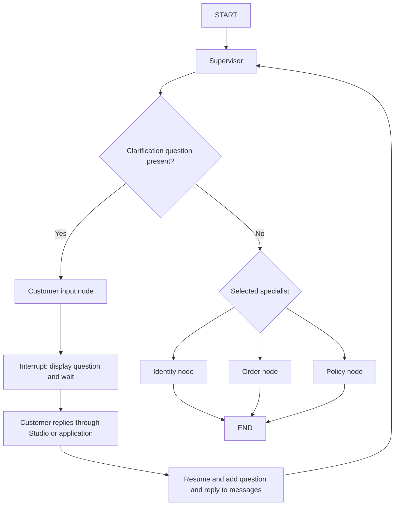

# Iteration 1

## Goal

Build the foundation of a custom multi-agent system (MAS) for retail customer support using LangGraph. In this iteration, focus on understanding a customer query, selecting a specialized agent, and collecting missing information through human-in-the-loop interaction.

Keep the architecture simple. Implement real retail operations and broader evaluation in later iterations.

## Technology and development workflow

- **Python and uv:** environment and dependency management.
- **LangGraph:** shared state, nodes, conditional routing, and interrupts.
- **LangChain with ChatOllama:** supervisor model integration. The current configuration uses `qwen3:4b`.
- **Pydantic:** structured supervisor output.
- **LangGraph development server and LangSmith Studio:** graph visualization and interactive inspection. LangSmith traces support monitoring model and graph behavior.
- **DeepEval:** planned evaluation framework; evaluation has not been implemented or verified in this iteration.
- **τ³ retail benchmark:** future evaluation target. Its exact version, policies, tools, and integration requirements still need review.

## Current project structure

| File | Responsibility |
|---|---|
| `src/state.py` | Shared conversation state used by the graph |
| `src/objects.py` | Pydantic schema for supervisor output |
| `src/models.py` | Model configuration |
| `src/prompts.py` | Supervisor instructions and examples |
| `src/nodes.py` | Supervisor, customer input, and specialist node functions |
| `src/graphs.py` | Graph construction and conditional routing |
| `src/routing.py` | Reserved for routing logic; currently empty in the last reviewed version |
| `langgraph.json` | Development server configuration pointing to `src.graphs:graph` |
| `main.py` | Placeholder entry point; does not currently run the conversation workflow |

## Architecture decisions

### One shared state

The initial design included task IDs, task lists, and task-level tracking. The scope was simplified to one active customer request at a time, using a shared `RetailState`.

The shared fields are:

| Field | Meaning |
|---|---|
| `messages` | Conversation history, merged using `add_messages` |
| `intent` | Classified request category |
| `order_id` | Extracted order identifier, or `None` |
| `user_id` | Extracted customer identifier, or `None` |
| `next_agent` | Intended destination: identity, order, or policy |
| `clarification_question` | Question to ask the customer, or `None` |

Current intent categories are `refund/return`, `delivery`, `product`, and `order`. Their boundaries and routing rules still need refinement.

### Structured supervisor output

`SupervisorOutput` contains the supervisor's decision and extracted information. The supervisor node translates that response into graph-state updates.

The output includes `next_agent`, `intent`, `order_id`, `user_id`, and `clarification_question`. It does not need to reproduce the conversation history.

### Human-in-the-loop clarification

Clarification is a control-flow step, not a separate LLM agent. The node was renamed from `clarification_node` to `customer_input_node` to make this distinction clearer.

The intended specialist remains in `next_agent`. A populated `clarification_question` takes priority over specialist dispatch.

## Current workflow

1. The customer supplies a query in `messages`.
2. The supervisor reads the conversation and known identifiers, classifies intent, and returns structured output.
3. If information is missing, the graph routes to `customer_input_node`.
4. `interrupt()` pauses execution and exposes the question to the caller. The caller displays it and collects the reply.
5. The caller resumes the same thread. The node records the question and answer, clears the pending question, and returns to the supervisor.
6. When no clarification is required, the selected specialist receives the request.

The specialist nodes currently return placeholder acknowledgements and then end execution. They do not access customer records or execute retail actions.

## Issues encountered and resolutions

| Issue | Resolution or current position |
|---|---|
| Workspace checkout did not show newly pushed code | Subsequent reviews read the latest GitHub version through temporary copies, leaving the workspace checkout unchanged. |
| Original graph configuration loaded a Python file whose relative import failed | Onboarding used an ignored local module-import configuration. The later repository configuration points to `src.graphs:graph`. |
| `NotRequired` was proposed for Pydantic output | Use `str \| None = None` for optional nullable Pydantic fields. Reserve `NotRequired` for `TypedDict` keys. |
| State and output used different intent labels | Aligned both to the same intent literals in the last reviewed code. |
| Renaming introduced `customer_input`, `customer_input_node`, and `clarification_question` as competing state fields | Kept `customer_input_node` as the node name and `clarification_question` as the data field. |
| Routing still returned `clarification` after the node rename | Updated routing to return `customer_input_node`, matching the conditional route map. |
| The question was cleared with `None`, but state declared only `str` | Updated the state field to `NotRequired[str \| None]`. |
| Explicit checkpointing caused an error in the server workflow | Keep `builder.compile()` when using the LangGraph development server's managed persistence. Direct standalone Python execution requires a checkpointer for interrupt/resume. |

LangSmith tracing alone does not provide checkpointing. Persistence in the current interactive workflow comes from the LangGraph server.

## Identity verification decision

The identity node remains in the current graph as a placeholder. Removing the standalone identity LLM agent was recommended for simplicity, but has not been confirmed as implemented.

Identity requirements must still be enforced wherever the target retail policy requires them. A future shared tool workflow can identify the customer before customer-specific operations, without requiring a separate LLM agent.

Identification, authorization, and confirmation are distinct. Finding a user ID does not automatically authorize access or approve a refund. The executing workflow must apply the relevant policy and confirmation requirements.

The current `supervisor → identity → END` path does not enforce verification before order access; that dependency must be implemented when real tools are added.

## Validation and evidence

- During initial environment onboarding, locked dependencies installed and passed compatibility checks. Direct and HTTP execution of the earlier greeting graph passed.
- Later source reviews confirmed consistent naming and routing for the customer input flow in commit `ae951b8`.
- Those reviews did **not** execute the updated supervisor model or verify a complete interrupt/resume conversation.
- The user is currently visualizing and monitoring through the LangGraph/LangSmith workflow. This document does not establish a specific successful end-to-end test result.
- No completed DeepEval run or τ³ benchmark run has been established.

The earlier greeting checks validate the environment at that point; they do not validate the newer MAS implementation.

## Remaining limitations

- Specialists have no real tools, business rules, or retail data integration yet.
- Unsupported requests appear in the prompt, but the output schema has no explicit unsupported outcome.
- Product-question routing and required fields for each action need explicit definitions.
- Retaining old identifiers when the model returns `None` can carry an unrelated order ID into a new request.
- The supervisor's classification and clarification behavior still require model-level testing.
- Customer identification is not yet an enforced prerequisite for protected operations.
- Full multi-request orchestration is outside the current scope.

## Next iteration

**Milestone: one complete order-status conversation backed by tools and a small set of evaluation scenarios.**

1. Inspect the chosen benchmark version's retail policy, tools, and user-simulator interface.
2. Define 10–15 representative scenarios before building a large dataset.
3. Implement one read-only order-status workflow using benchmark tools, or a small mock store if integration is not yet available.
4. Verify direct dispatch, missing-ID clarification, resumed execution, lookup failures, and grounded final responses.
5. Record routes, tool calls, and outcomes for later evaluation.
6. Expand policy support and state-changing actions after the first workflow works reliably.

Keep operational data—orders, customers, products, and policies—separate from evaluation cases containing queries and expected behavior. Use DeepEval for appropriate application-level checks and the benchmark's prescribed procedure for benchmark results.

## Iteration outcome

The project now has a basic supervisor-routing structure and a human-in-the-loop clarification design. The next work is to validate that interaction end to end and replace a specialist placeholder with a real retail workflow.
